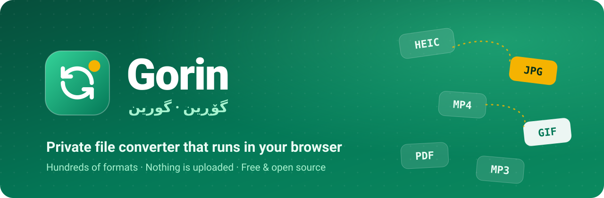

<p align="center">
  <a href="https://mostafasadeghidev.github.io/gorin/"></a>
</p>

<p align="center">
  <a href="README.md">English</a> · <a href="README.fa.md">فارسی</a> · <b>کوردی</b>
</p>

<p align="center">
  <a href="https://mostafasadeghidev.github.io/gorin/"></a>
  <a href="https://github.com/mostafasadeghidev/gorin/releases/tag/latest"></a>
</p>

<div dir="rtl">

<h3 align="center">نزیکەی هەر فایلێک بگۆڕە بۆ نزیکەی هەر فۆرماتێک، ڕاستەوخۆ لە وێبگەڕەکەتدا.</h3>

<p align="center"><i>«گۆڕین» لە کوردیدا واتە «گۆڕانکاری کردن».</i></p>

---

## ✨ بۆچی گۆڕین؟

<table dir="rtl">
  <tr>
    <td width="50%" valign="top">
      <h3>🔒 تایبەت</h3>
      هەموو شتێک لەسەر ئامێرەکەی خۆت ئەنجام دەدرێت. فایلەکانت هەرگیز بۆ هیچ شوێنێک بار ناکرێن، تەنانەت بۆ ئێمەش.
    </td>
    <td width="50%" valign="top">
      <h3>🔄 سەدان فۆرمات</h3>
      وێنە، ڤیدیۆ، دەنگ، بەڵگەنامە، فۆنت، مۆدێلی سێ‌ڕەهەندی و زۆر شتی تر. تەنانەت لە نێوان جۆرە جیاوازەکانیش دەگۆڕێت: وێنە ← PDF، ڤیدیۆ ← GIF، بەڵگەنامە ← وێنە.
    </td>
  </tr>
  <tr>
    <td width="50%" valign="top">
      <h3>📦 چەند فایل پێکەوە</h3>
      بوخچەیەک وێنە بە یەکجار دابنێ، تەنانەت ئەگەر فۆرماتەکانیان تێکەڵ بن وەک PNG و HEIC و BMP. هەر فایلێک دەرچووی تایبەتی خۆی وەردەگرێت و دەتوانیت یەک یەک یان هەمووی پێکەوە وەک ZIP دایانبگریت.
    </td>
    <td width="50%" valign="top">
      <h3>🌍 بەخۆڕایی و فرەزمان</h3>
      بێ خۆتۆمارکردن، بێ سنوور، بێ ڕیکلام. ڕووکارەکە بە ئینگلیزی، فارسی و کوردیی سۆرانییە و بە تەواوی پشتگیری لە ڕاست بۆ چەپ دەکات.
    </td>
  </tr>
</table>

## 🚀 چۆن بەکاری بهێنم؟

| هەنگاو | چی بکەم                                                                                             |
| :----: | --------------------------------------------------------------------------------------------------- |
| **١**  | ماڵپەڕی **[mostafasadeghidev.github.io/gorin](https://mostafasadeghidev.github.io/gorin/)** بکەرەوە |
| **٢**  | کرتە لە چوارگۆشە گەورەکە بکە، فایلەکان ڕابکێشە سەر پەڕەکە، یان بیانلکێنە                            |
| **٣**  | گۆڕین خۆی فۆرماتی فایلەکە دەناسێتەوە و بەسوودترین دەرچووەکان پێشنیار دەکات                          |
| **٤**  | فۆرماتی دەرچوو هەڵبژێرە و **بگۆڕە** دابگرە. تەواو!                                                  |

> [!TIP]
> ئەو فۆرماتەی دەتەوێت لە پێشنیارەکاندا نییە؟ ناوەکەی لە خانەی گەڕاندا بنووسە، یان **پیشاندانی هەموو** دابگرە.

## 💻 بەرنامەی دێسکتۆپ

بەرنامەیەکت دەوێت کە بە تەواوی بێ ئینتەرنێت کار بکات؟ لە **[پەڕەی وەشانەکان](https://github.com/mostafasadeghidev/gorin/releases/tag/latest)** دایبگرە:

| سیستەم    | داگرتن                                                                                                                                                                                                           | تێبینی                                                                         |
| --------- | ---------------------------------------------------------------------------------------------------------------------------------------------------------------------------------------------------------------- | ------------------------------------------------------------------------------ |
| 🪟 ویندۆز | [دامەزراندن](https://github.com/mostafasadeghidev/gorin/releases/download/latest/gorin-win-x64.exe) · [گوازراوە](https://github.com/mostafasadeghidev/gorin/releases/download/latest/gorin-win-x64-portable.exe) | وەشانی دامەزراندن خۆی نوێ دەکاتەوە؛ وەشانی گوازراوە پێویستی بە دامەزراندن نییە |
| 🍎 ماک    | [DMG](https://github.com/mostafasadeghidev/gorin/releases/download/latest/gorin-mac-arm64.dmg)                                                                                                                   | ماکەکانی Apple Silicon (M1 و نوێتر)                                            |
| 🐧 لینوکس | [AppImage](https://github.com/mostafasadeghidev/gorin/releases/download/latest/gorin-linux-x86_64.AppImage)                                                                                                      | ڕێگەی جێبەجێکردنی پێ بدە و بیکەرەوە                                            |

> [!NOTE]
> بەرنامەکان هێشتا واژۆی دیجیتاڵیان نییە. لە ویندۆزدا **More info** و پاشان **Run anyway** دابگرە. لە ماکدا کرتەی ڕاست لە بەرنامەکە بکە و **Open** هەڵبژێرە.

## 🛠️ گەشەپێدان

<details>
<summary><b>کارپێکردن لەسەر ئامێری خۆت</b></summary>

١. [Bun](https://bun.sh/) دابمەزرێنە.<br>
٢. فەرمانی `bun install` جێبەجێ بکە.<br>
٣. بە `bun run dev` پێداویستییەکان ئامادە دەبن و ڕاژەکاری گەشەپێدان دەست پێدەکات.

بۆ وەشانی کۆتایی، `bun run build` و پاشان `bun run cache:build` جێبەجێ بکە و بوخچەی `dist/` بە هەر ڕاژەکارێکی HTTPی سادە بڵاو بکەرەوە. بە هەر push ێک بۆ `master`، ماڵپەڕەکە لەسەر GitHub Pages بڵاو دەبێتەوە و بەرنامەکانی دێسکتۆپ بە شێوەی خۆکار دروست دەکرێنەوە.

</details>

<details>
<summary><b>داکەر</b></summary>

```bash
docker compose -f docker/docker-compose.yml -f docker/docker-compose.override.yml up --build -d
```

ماڵپەڕەکە لەسەر `http://localhost:8080/convert/` بەردەست دەبێت.

</details>

<details>
<summary><b>پێکهاتەی پڕۆژە</b></summary>

- `src/handlers/`: بۆ هەر ئامرازێکی گۆڕین «هەندڵەرێک». هەر هەندڵەرێک ئەو فۆرماتانە دیاری دەکات کە دەیانخوێنێتەوە و دەیاننووسێت، و `doConvert` جێبەجێ دەکات. ڕووکارەکەی لە `src/FormatHandler.ts`دایە و هەندڵەری نوێ لە `src/handlers/index.ts` تۆمار بکە.
- `src/ui/`: ڕووکاری بەکارهێنەر بە Preact. وەرگێڕانەکان لە `src/ui/i18n.ts`دان.
- `recipe/` و `prebuilt/`: پێداویستییە دەرەکییەکان کە لە کاتی دروستکردندا کۆ دەکرێنەوە (`bun run build:assemble`).
- `test/`: تاقیکردنەوەکانی گۆڕین و دۆزینەوەی ڕێگا (`bun test ./test/`).

</details>

## 📄 مۆڵەت

گۆڕین نەرمەکاڵایەکی ئازادە و بە مۆڵەتی [GNU General Public License v2.0](LICENSE) بڵاو دەکرێتەوە. لەسەر بنەمای پڕۆژەیەکی سەرچاوە‌کراوەی گۆڕینی فایل بە مۆڵەتی GPL-2.0 دروست کراوە و هەمان مۆڵەت دەپارێزێت.

<p align="center"><sub>بە 💚 بۆ هەموو ئەوانەی تەنها دەیانەوێت فایلەکەیان فۆرماتێکی تری هەبێت.</sub></p>

</div>
