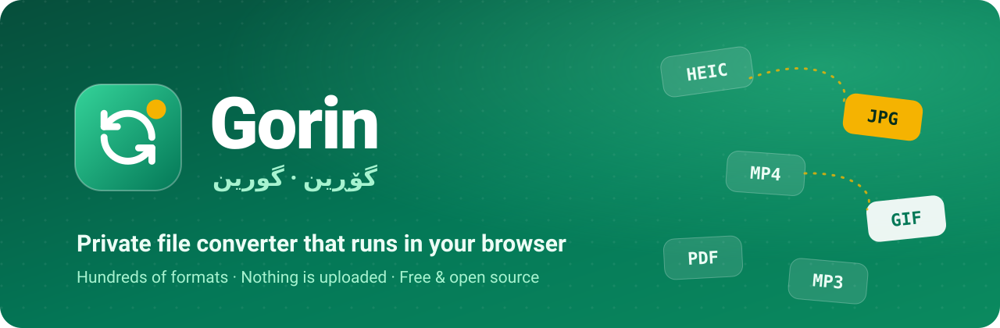

<p align="center">
  <a href="https://mostafasadeghidev.github.io/gorin/"></a>
</p>

<p align="center">
  <a href="README.md">English</a> · <b>فارسی</b> · <a href="README.ckb.md">کوردی</a>
</p>

<p align="center">
  <a href="https://mostafasadeghidev.github.io/gorin/"></a>
  <a href="https://github.com/mostafasadeghidev/gorin/releases/tag/latest"></a>
</p>

<div dir="rtl">

<h3 align="center">تقریباً هر فایلی را به تقریباً هر فرمتی تبدیل کن، همین‌جا در مرورگرت.</h3>

<p align="center"><i>«گۆڕین» در زبان کردی یعنی «تغییر دادن».</i></p>

---

## ✨ چرا گورین؟

<table dir="rtl">
  <tr>
    <td width="50%" valign="top">
      <h3>🔒 خصوصی</h3>
      همه‌چیز روی دستگاه خودت انجام می‌شود. فایل‌هایت هیچ‌وقت جایی آپلود نمی‌شوند، حتی برای ما.
    </td>
    <td width="50%" valign="top">
      <h3>🔄 صدها فرمت</h3>
      عکس، ویدیو، صدا، سند، فونت، مدل سه‌بعدی و خیلی چیزهای دیگر. حتی بین نوع‌های مختلف هم تبدیل می‌کند: عکس ← PDF، ویدیو ← GIF، سند ← عکس.
    </td>
  </tr>
  <tr>
    <td width="50%" valign="top">
      <h3>📦 چند فایل با هم</h3>
      یک پوشه عکس را یک‌جا بینداز، حتی با فرمت‌های قاطی مثل PNG و HEIC و BMP. هر فایل خروجی خودش را می‌گیرد و می‌توانی تک‌تک یا همه را یک‌جا در یک ZIP دانلود کنی.
    </td>
    <td width="50%" valign="top">
      <h3>🌍 رایگان و چندزبانه</h3>
      بدون ثبت‌نام، بدون محدودیت، بدون تبلیغ. رابط کاربری به انگلیسی، فارسی و کردی سورانی است و راست‌به‌چپ را کامل پشتیبانی می‌کند.
    </td>
  </tr>
</table>

## 🚀 چطور استفاده کنم؟

| مرحله | چه کار کنم                                                                                         |
| :---: | -------------------------------------------------------------------------------------------------- |
| **۱** | سایت **[mostafasadeghidev.github.io/gorin](https://mostafasadeghidev.github.io/gorin/)** را باز کن |
| **۲** | روی کادر بزرگ کلیک کن، فایل‌ها را روی صفحه بکش، یا پیست کن                                         |
| **۳** | گورین فرمت فایل را خودش تشخیص می‌دهد و پرکاربردترین خروجی‌ها را پیشنهاد می‌کند                     |
| **۴** | فرمت خروجی را انتخاب کن و **تبدیل** را بزن. تمام!                                                  |

> 💡 **نکته:** فرمتی که می‌خواهی بین پیشنهادها نیست؟ اسمش را در کادر جست‌وجو بنویس یا **نمایش همه** را بزن.

## 💻 برنامهٔ دسکتاپ

برنامه‌ای می‌خواهی که کاملاً آفلاین کار کند؟ از **[صفحهٔ نسخه‌ها](https://github.com/mostafasadeghidev/gorin/releases/tag/latest)** دانلودش کن:

| سیستم‌عامل | دانلود                                                                                                                                                                                                   | توضیح                                                      |
| ---------- | -------------------------------------------------------------------------------------------------------------------------------------------------------------------------------------------------------- | ---------------------------------------------------------- |
| 🪟 ویندوز  | [نصبی](https://github.com/mostafasadeghidev/gorin/releases/download/latest/gorin-win-x64.exe) · [پرتابل](https://github.com/mostafasadeghidev/gorin/releases/download/latest/gorin-win-x64-portable.exe) | نسخهٔ نصبی خودش به‌روز می‌شود؛ نسخهٔ پرتابل نصب لازم ندارد |
| 🍎 مک      | [DMG](https://github.com/mostafasadeghidev/gorin/releases/download/latest/gorin-mac-arm64.dmg)                                                                                                           | مک‌های اپل سیلیکون (M1 به بعد)                             |
| 🐧 لینوکس  | [AppImage](https://github.com/mostafasadeghidev/gorin/releases/download/latest/gorin-linux-x86_64.AppImage)                                                                                              | اجازهٔ اجرا بده و بازش کن                                  |

> ⚠️ **توجه:** برنامه‌ها هنوز امضای دیجیتال ندارند. در ویندوز روی **More info** و بعد **Run anyway** بزن. در مک روی برنامه راست‌کلیک کن و **Open** را بزن.

## 🛠️ توسعه

<details>
<summary><b>اجرا روی سیستم خودت</b></summary>

۱. [Bun](https://bun.sh/) را نصب کن.<br>
۲. دستور `bun install` را اجرا کن.<br>
۳. با `bun run dev` وابستگی‌ها آماده می‌شوند و سرور توسعه بالا می‌آید.

برای نسخهٔ نهایی، `bun run build` و بعد `bun run cache:build` را اجرا کن و پوشهٔ `dist/` را با هر سرور HTTP ساده‌ای سرو کن. با هر پوش روی `master`، سایت روی GitHub Pages منتشر و برنامه‌های دسکتاپ خودکار ساخته می‌شوند.

</details>

<details>
<summary><b>داکر</b></summary>

```bash
docker compose -f docker/docker-compose.yml -f docker/docker-compose.override.yml up --build -d
```

سایت روی `http://localhost:8080/gorin/` در دسترس است.

</details>

<details>
<summary><b>ساختار پروژه</b></summary>

- `src/handlers/`: برای هر ابزار تبدیل یک «هندلر». هر هندلر فرمت‌هایی را که می‌خواند و می‌نویسد اعلام می‌کند و `doConvert` را پیاده می‌کند. رابطش در `src/FormatHandler.ts` است و هندلر جدید را در `src/handlers/index.ts` ثبت کن.
- `src/ui/`: رابط کاربری با Preact. ترجمه‌ها در `src/ui/i18n.ts` هستند.
- `recipe/` و `prebuilt/`: وابستگی‌های بیرونی که موقع ساخت جمع می‌شوند (`bun run build:assemble`).
- `test/`: تست‌های تبدیل و مسیریابی (`bun test ./test/`).

</details>

## 📄 مجوز

گورین نرم‌افزار آزاد است و با مجوز [GNU General Public License v2.0](LICENSE) منتشر می‌شود. این برنامه بر پایهٔ یک پروژهٔ متن‌باز تبدیل فایل با مجوز GPL-2.0 ساخته شده و همان مجوز را حفظ می‌کند.

<p align="center"><sub>با 💚 برای همه‌ی کسانی که فقط می‌خواهند فایلشان فرمت دیگری داشته باشد.</sub></p>

</div>
