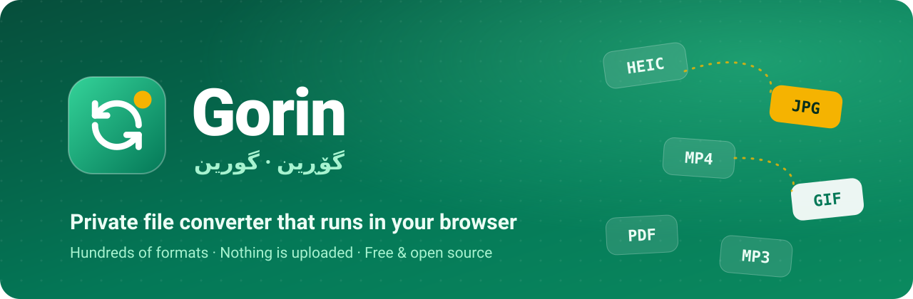

<p align="center">
  <a href="https://mostafasadeghidev.github.io/gorin/"></a>
</p>

<p align="center">
  <b>English</b> · <a href="README.fa.md">فارسی</a> · <a href="README.ckb.md">کوردی</a>
</p>

<p align="center">
  <a href="https://mostafasadeghidev.github.io/gorin/"></a>
  <a href="https://github.com/mostafasadeghidev/gorin/releases/latest"></a>
</p>

<p align="center">
  
  
  
</p>

<h3 align="center">Convert almost any file to almost any format, right in your browser.</h3>

<p align="center"><i>Gorin (گۆڕین) means “to change” in Kurdish.</i></p>

---

## ✨ Why Gorin?

<table>
  <tr>
    <td width="50%" valign="top">
      <h3>🔒 Private</h3>
      Everything runs on your own device. Your files are never uploaded anywhere, not even to us.
    </td>
    <td width="50%" valign="top">
      <h3>🔄 Hundreds of formats</h3>
      Images, video, audio, documents, fonts, 3D models and more. It can even cross mediums: image → PDF, video → GIF, document → image.
    </td>
  </tr>
  <tr>
    <td width="50%" valign="top">
      <h3>📦 Many files at once</h3>
      Drop a whole folder of photos, even mixed types like PNG + HEIC + BMP. Every file gets its own output, and you can download them one by one or all as a ZIP.
    </td>
    <td width="50%" valign="top">
      <h3>🌍 Free and multilingual</h3>
      No sign-up, no limits, no ads. The interface speaks English, Persian and Kurdish (Sorani), with full right-to-left support.
    </td>
  </tr>
</table>

## 🚀 How to use

| Step  | What to do                                                                               |
| :---: | ---------------------------------------------------------------------------------------- |
| **1** | Open **[mostafasadeghidev.github.io/gorin](https://mostafasadeghidev.github.io/gorin/)** |
| **2** | Click the big box, drag your files onto the page, or paste them                          |
| **3** | Gorin detects the input format and suggests the most useful outputs                      |
| **4** | Pick an output format and press **Convert**. Done!                                       |

> [!TIP]
> Can’t find the format you want among the suggestions? Type it in the search box, or press **Show all**.

## 💻 Desktop app

Prefer an app that works fully offline? Download it from the **[releases page](https://github.com/mostafasadeghidev/gorin/releases/latest)**:

| System     | Download                                                                                                                                                                                                        | Notes                                                               |
| ---------- | --------------------------------------------------------------------------------------------------------------------------------------------------------------------------------------------------------------- | ------------------------------------------------------------------- |
| 🪟 Windows | [Installer](https://github.com/mostafasadeghidev/gorin/releases/latest/download/gorin-win-x64.exe) · [Portable](https://github.com/mostafasadeghidev/gorin/releases/latest/download/gorin-win-x64-portable.exe) | The installer updates itself; the portable version needs no install |
| 🍎 macOS   | [DMG](https://github.com/mostafasadeghidev/gorin/releases/latest/download/gorin-mac-arm64.dmg)                                                                                                                  | Apple Silicon (M1 and newer)                                        |
| 🐧 Linux   | [AppImage](https://github.com/mostafasadeghidev/gorin/releases/latest/download/gorin-linux-x86_64.AppImage)                                                                                                     | Make it executable, then run it                                     |

> [!NOTE]
> The apps aren’t code-signed yet. On Windows, choose **More info → Run anyway**. On macOS, right-click the app and choose **Open**.

## 🛠️ Development

<details>
<summary><b>Run it locally</b></summary>

1. Install [Bun](https://bun.sh/).
2. Run `bun install`.
3. Run `bun run dev` to prepare dependencies and start the dev server.

For a production build, run `bun run build` and then `bun run cache:build`, and serve the `dist/` folder with any static HTTP server. Pushing to `master` deploys the site to GitHub Pages. To release the desktop apps, add release notes in `.github/release-notes/vX.Y.Z.md` and push a `vX.Y.Z` tag.

</details>

<details>
<summary><b>Docker</b></summary>

```bash
docker compose -f docker/docker-compose.yml -f docker/docker-compose.override.yml up --build -d
```

The site will be available at `http://localhost:8080/gorin/`.

</details>

<details>
<summary><b>Project layout</b></summary>

- `src/handlers/`: one wrapper ("handler") per conversion tool. Each handler lists the formats it can read and write, and implements `doConvert`. See `src/FormatHandler.ts` for the interface, and register new handlers in `src/handlers/index.ts`.
- `src/ui/`: the Preact interface. Translations live in `src/ui/i18n.ts`.
- `recipe/` and `prebuilt/`: external dependencies assembled at build time (`bun run build:assemble`).
- `test/`: conversion and graph traversal tests (`bun test ./test/`).

</details>

## 📄 License

Gorin is free software, licensed under the [GNU General Public License v2.0](LICENSE). It is based on an existing open-source GPL-2.0 file converter project and remains under the same license.

<p align="center"><sub>Made with 💚 for everyone who just wants their file in a different format.</sub></p>
